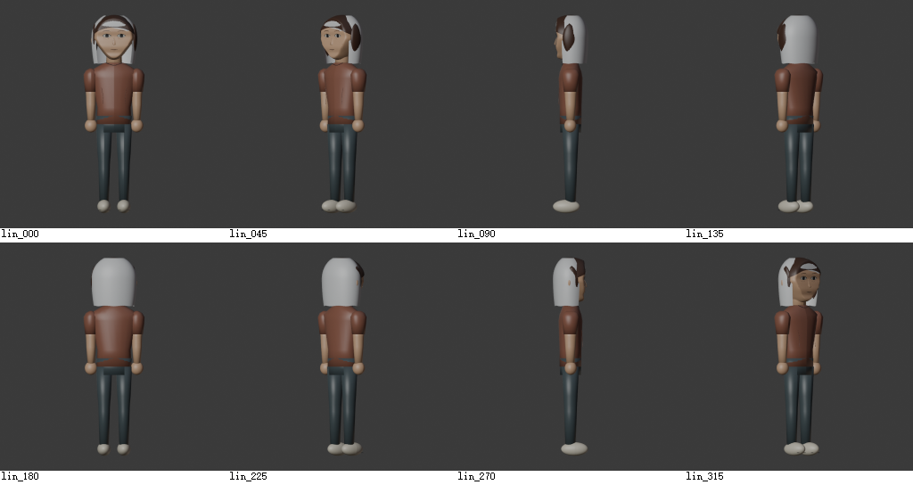

# P0 · 林夏（lin）当前角色审计

样本来自 avatar-schema.js 的原班角色 lin 外观，经正常 makeCustomActor 入口生成。当前 blend 是动画参考文件的逐字节备份。SHA-256 为 A7524E03200BB9E398BF1B6B1BE0AB4F79488581668BEAA5CBFA9DDDF7835147。运行时模型由 Three.js 生成，材质入口为 avatar-material.js，装配与播放入口为 characters.js、humanoid-rig.js、base-motion.js、authored-motion.js。场景没有独立角色 prefab 或 Unity Animator。

## 比例

H 取静置鞋底至裸头顶，1.8906 场景单位，HH 为裸头网格高度，合 4.463 头身。胸腰臀取衣壳对应截面，肩宽取躯干肩截面，手取掌网格纵径，脚取鞋网格前后径。各截面及计算见 build/p0-temp.mjs。当前资产无独立裸躯干，这些为衣壳代理测量。

| ID | 比例 | 实测 | 规格 | 结果 |
|---|---|---:|---|---|
| A1 | HH/H | .2240 | .18–.22 | 超 |
| A2 | SW/HW | 1.2066 | .95–1.15 | 超 |
| A3 | HD/HW | .7235 | 1.05–1.25 | 低 |
| A4 | 胸深/胸宽 | .5208 | .65–.80 | 低 |
| A5 | 腰宽/胸宽 | .7246 | .68–.82 | 过 |
| A6 | 臀宽/胸宽 | .7699 | .85–1 | 低 |
| A7 | 上臂加前臂/H | .2544 | .34–.40 | 低 |
| A8 | 髋踝高差/H | .4179 | .44–.50 | 低 |
| A9 | 手长/HH | .3069 | .34–.46 | 低 |
| A10 | 脚长/HH | .6138 | .50–.62 | 过 |

## 骨架与权重

参考 blend 只有一个 Armature、52 根 deform，动作 A01、A26、A27、play-follow、play-lead。标准骨名匹配 0。B02/B03 空比较，不能采信 PASS。骨长和父子逐骨见同名 JSON 的 sourceBones。M00 源于场景无网格。运行时同样有 52 个骨节点，其中包括 30 个指骨节点，手臂静置向下。运行时逐骨父子及到父节点的偏移长度见 runtime.joints。可见非描边蒙皮顶点 2769，最大 2 影响，零权重 0，权重和超差 0。刚性挂接单件另计，未验证极限姿势。运行时另有 retargeted-motion.json 的 Walking、Dance、Wave，程序动作入口为 base-assets.json、base-score.js、action-catalog.js。

## 侧视与制作结论

图由静置运行时顶点、三角面和基础色在 Blender Workbench 重绘。游戏着色、透明、描边与贴图未复现，头发白区不可作为配色证据。建议保留角色身份、外观参数与演出映射，重建头体基础网格与标准骨架。成人默认 adult_f 4.8、adult_m 5.0，保留 child、teen、tall_m。P2 依次检查 S1 鼻尖突出 >0.08 HD、S2 后脑越过 −0.35 HD、S3 下颌角露出、S4 耳位于眼后且侧面可见、S5 左右侧视各见一眼、S6 后发超后脑 0.03–0.05 HU、S7 下颌至锁骨留 0.05–0.07 m、S8 肩线斜下 10–14°、S9 八向材质及剪影逐对比对。P0 只建立基线。

## 下阶段规格冲突

adult_f 与 adult_m 的 CSV 上臂加前臂/H 分别为 .2875、.2760；加上手长分别为 .3708、.3560。A7 的文字公式排除了手。建议先统一公式及测量端点再执行 P1。骨数按任务的严格 24 根处理。
